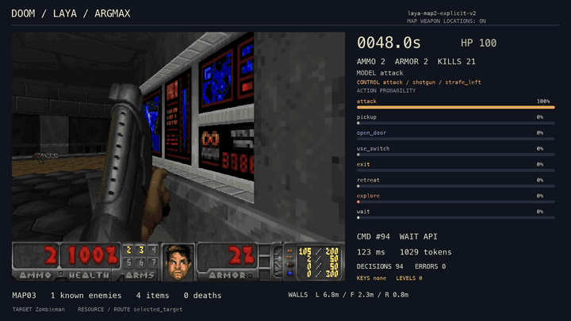
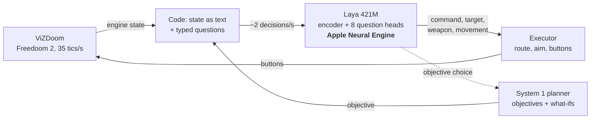

# doomANE

**A 421M decision model plays Freedoom in real time, with every forward pass on the Apple Neural Engine.**
A System 1 planner lets the same small model choose objectives as well as moves: code works out what each
objective would open, and the model picks one. It finishes the first three maps and, at skill 1, the
fourth; at skill 3 it finds the fourth map's whole route and then dies in the fights. This repository has
the code, the data, and an honest account of what helped and what did not.




*Freedoom MAP03, skill 3, real time: a win with no deaths in 319 s. The panel shows the command the model
chose, its probability for every command, the weapon and movement it picked, and the decision latency.
Nothing on the panel is chosen by code.*

## Results in short


| | |
|---|---|
| **Speed** | Encoder and question heads on the ANE: a median of about 110–140 ms per decision in play (about 420 ms with only the encoder there). Real time at 35 tics/s. |
| **MAP01–03** | Skill 3, real time, a death restarts the map from a pistol start (batch exec5): 10/10, 8/10, 4/10. MAP03 is noisy: 16/51 over the later stacks. |
| **MAP04** | A development map since 2026-10-23 (its failures drove the route fixes). Generic route rules find its whole route: **3/3 at skill 1**, and once more inside a campaign. At skill 3, **0/79**: the route takes 500–700 s, and one death after the keys ends the run. |
| **Held-out maps** | 0/18 on six held-out maps, like the doomLaya v0.3.1 we started from. With the route rules, from a frozen snapshot on new seeds: 0/18 again, with no more keys or doors. At skill 1, where it barely dies on most of them: 0/18, with twice the keys. MAP11 and MAP15 lost real time in both, so those games are invalid. |
| **Random baseline** | The same stack with every choice replaced by a random option: 0/12 on MAP01–03, against 7/12 for Laya in the same session, with 370 deaths against 45. |
| **Campaigns** | One hour from MAP01. Pistol start on every map: skill 3 reached MAP03 and MAP04, skill 1 MAP03 and MAP05. With the inventory carried over as in vanilla Doom: skill 3 MAP03 and MAP02, skill 1 MAP05 twice. Within the noise of 2 seeds. |
| **Where it stopped** | Fighting. Every lever on the decision side was tested and came up flat. |

The full story is in [docs/WRITEUP.md](docs/WRITEUP.md), and every batch, table and dead end is in the
[lab notebook](docs/LAB_NOTEBOOK.md).

## How it works



- **The model chooses; code executes.** Code turns the game into text and asks typed questions (which
  command, enemy, item, weapon, movement). The executor routes, aims and presses buttons for the chosen
  command, and never picks a target, a weapon or an exit itself. `tools/check_authority.py` audits every
  run, and a completion counts only if the run passes.
- **Laya** is the doomLaya v0.3.1 fine-tune of Laya (ModernBERT-large, 421M): one shared encoder, eight
  question heads and small numeric residuals, all as Core ML on the ANE (the encoder as one multifunction
  package of seven sequence lengths, 0.76 GB).
- **Route knowledge is generic:** a table of Doom 2's linedef specials, lifts, crushers and headroom. No
  map name, line number or coordinate is used in the code's logic.


## System 1 planning

Laya answers every half second from one snapshot of the game, with no plan and no memory; on its own it
shuttled between three switches on MAP03 for 15 minutes with the red key about 5 m away. The planner
(`doom/planner.py`) splits the work: **code does the search, the model does the choosing.** Code lists the
reachable objectives (keys, switches, lifts, the exit, exploring), with what-ifs of what each would open
two steps ahead. Laya picks one through an ordinary `choice` question, only on events (an objective done or
failed, a key, door or floor change, a respawn), and the objective then narrows the 2 Hz route options.

The first objective question of a winning MAP04 game (skill 1, seed 101):

| Option | Laya's probability |
|---|---|
| Use floor switch #883, 22m away; reachable now. Opens: red key (which opens lift #463). On the way to: red key. Not tried yet. | **0.69** |
| Collect the Shotgun (#1), 4m away; reachable now. A weapon not yet owned. Not tried yet. | 0.31 |
| Collect the SuperShotgun (#weapon_27), 25m away; reachable now. A weapon not yet owned. Not tried yet. | 0.005 |
| Use door switch #879, 30m away; reachable now. Opens: nothing new found. Not tried yet. | 0.00 |
| No fixed objective: explore accessible areas for another route. Not tried yet. | 0.00 |

Zero-shot, Laya's first objective was the first step of the real route on MAP01–04. On the same four
seeds of MAP01–03, the planner raised completions from 7–8 of 12 to 10 of 12, and the gain came from the
facts and filters code gives it, not from the question. A local LLM in its place (Qwen3 8B and 27B, MLX)
chose no better. Details: [docs/research/System 1 planning/notes.md](docs/research/System%201%20planning/notes.md).

## What we learned

The method, a small fast model choosing among options that code lists, works as an on-device chooser whose
every decision can be audited. It does not make the bot good at Doom: it is only as good as the options it
is offered and the actions the executor can carry out.

1. **Speed is the easy part.** A game asks about two decisions a second, so an ANE server is busy only
   about a quarter of the time.
2. **It chooses well, but cannot judge.** Given concrete options it picks sensibly, even zero-shot. Yes/no
   judgements ("making progress?", "pull back?") were at chance (AUROC 0.36–0.52), with yes 70–95 % of the
   time whatever the facts.
3. **Wording is a weapon.** Option names, wording and order move choices by tens of percent, and names
   weigh more than the conditions in them: "Ammo: N" against "Shots left: N" moved choices that cannot hit
   from 0 to 35 in 200 replayed questions. Test a new wording offline before playing it.
4. **You cannot tell it things, and the numbers often decide.** Free-text hints changed no command in 463
   replays. A small numeric residual on top of Laya changes the command in 21–50 % of decisions.
5. **Its competence is partly borrowed.** Most gains came from code: executor fixes, the planner's option
   lists, the route rules. That code was shaped on the development maps and did not transfer to held-out
   ones. But the code alone does nothing: with random choices it finished 0 of 12 games on MAP01–03, against
   7 for Laya, and died eight times as often. The model's choices carry the play the code makes possible.
6. **The executor's actions set the ceiling.** Without a "fall back while firing" action, choosing to avoid
   a fight could not be carried out safely. Skill 1 shows the route is solved on the development maps; skill 3 shows survival is not. On held-out
   maps at skill 1 Laya survives and still finds no exit, so there the route is the limit.
7. **The decision layer is not where fights are lost.** A movement head trained on rollout outcomes from
   7,056 states beat the original offline but not in games; forcing each alternative command found none
   better than Laya's beyond the noise; Qwen 8B/27B as planner and untrained open decision models did no
   better. Cheap outcome labels teach short, local choices; which fight to take is a longer-horizon one.
8. **Single runs mislead.** One different decision sends a game down another path: the same seed gave 0,
   6 and 4 deaths on repeats. Use several seeds, paired offline replays, held-out maps played only from a
   frozen snapshot, and decide what each result means before the batch.

Going further needs richer executor actions, or something that learns values over longer horizons (a real
System 2, or far more game experience), not more questions or new wording.

## Compared with game AI

The design matches what shooters use for their enemies: the executor is a
behaviour tree, System 1 a utility AI that scores the options, and the planner a GOAP/HTN-style planner
(F.E.A.R., Killzone 2). Only the scorer is learned. The job is harder, though: enemies are built to lose,
never solve levels, and get hand-marked cover points, where this agent has to win at skill 3, find keys in
unknown maps, and has no fall-back action. Agents that do play as the player lean on authored help
(deathmatch bots' waypoints) or very large amounts of RL (the ViZDoom competition agents, GT Sophy).

## Quick start

**You need:** an Apple Silicon Mac, Xcode command line tools, and
`brew install uv ffmpeg cmake boost sdl2 openal-soft`. About 20 GB of disk.

```bash
git clone https://github.com/andrewgoodchild/doomANE.git && cd doomANE
scripts/setup.sh        # doomLaya v0.3.1 + our patch, venv, patched ViZDoom, checkpoints, Core ML export, tests
cd ext/doomLaya-dev
.venv/bin/python ../../doom/repeat_map.py --maps MAP01 --seeds 54 --configs planner_ext_safe --suffix demo
```

This starts an ANE model server, plays, verifies the run and audits authority. The run directory
(`runs/<time>_repeat-...`) holds `video.mp4`, `decisions.jsonl` (every question, answer and probability),
`events.jsonl`, `telemetry.jsonl` and `summary.json`; the result row goes to
`results/doom/repeat_map01_demo.json`.

| Task | Command (from `ext/doomLaya-dev`) |
|---|---|
| Several seeds and games at once | `.venv/bin/python ../../doom/repeat_map.py --maps MAP03 --seeds 1 2 3 4 --configs planner_ext_safe --parallel 4 --ane-servers 2` |
| Scenarios from saved fight states | `.venv/bin/python ../../doom/scenarios.py --runs runs/<run> --configs planner_ext_safe --seconds 15 --out out.jsonl` |
| Movement rollouts for training labels | `.venv/bin/python ../../doom/fight_rollouts.py runs/<run> --before-death 10 --out labels.jsonl` |
| Static route check | `.venv/bin/python ../../doom/route_solver.py MAP04 --extended --diagnose` |
| Freeze the stack (from the repository root) | `doom/snapshot_stack.sh <name>` |
| A campaign (from `ext/snap/<name>/ext/doomLaya`) | `.venv/bin/python ../../doom/repeat_map.py --maps MAP01 --campaign 3600 --seeds 301 --configs planner_ext_safe --evaluation --extra-flags='--carry-inventory'` |

- Always pass `--configs`; the `system2*` configs need a local MLX server.
- Core ML holds the ANE models of two processes at most. With `--parallel` above 2, the other servers run
  the same model on the GPU (identical answers on 40 of 40 checks). Game results are from ANE servers
  unless marked; scenarios and rollouts used GPU servers.
- Campaigns reach the held-out maps, so they run only from a snapshot with `--evaluation`.
  `--carry-inventory` carries weapons, ammo, backpack, health and armour to the next map as vanilla Doom
  does (ViZDoom would otherwise start every map from a pistol start), and stops the run if any field is not
  restored exactly.
- **Reproducing exact numbers:** `scripts/setup.sh` builds the final stack (2026-10-29). Earlier batches ran
  on earlier code (up to exec6 with `doom/patches/doomLaya-executor-fixes.patch`); each run directory keeps
  the exact source it ran. The run directories and videos are not in this repository.

## Repository layout

| Path | What |
|---|---|
| `doom/ane_doomlaya.py`, `doom/export_doom_*.py`, `doom/merge_doom_encoder.py` | The ANE model server and the Core ML export |
| `doom/planner.py`, `doom/system2.py` | The System 1 objective planner; the optional local LLM planner |
| `doom/repeat_map.py`, `doom/scenarios.py`, `doom/fight_rollouts.py` | Game batches, scenarios from saved states, outcome rollouts |
| `doom/route_solver.py`, `doom/map_split.json` | Static route checks; the development / held-out split |
| `doom/patches/doomLaya-dev.patch` | Everything we changed in doomLaya v0.3.1 |
| `coreml_cache.py` | Compile each Core ML package once (`MLModel(path)` leaks a compiled copy per load) |
| `results/doom/`, `results/doom_heads/` | Every batch's results; outcome labels and the trained movement residual |
| `docs/WRITEUP.md`, `docs/LAB_NOTEBOOK.md`, [`docs/research/`](docs/research/README.md) | Summary, dated record, research notes |

## Rules we kept

- **Authority:** the model chooses the command, target, weapon and movement; the executor carries them out.
  An API error is never replaced by a heuristic.
- **Real time:** wall and game time agree within 5 %.
- **Held-out maps** (odd Freedoom maps from MAP05, MAP31–32, an Obsidian set) are played only from a frozen
  snapshot, and their results are never used for fixes.
- **No hosted model** is in the decision loop or produces training data (the `memory` config's command
  residual was trained on a hand-written rule).

Where code still decides, or we broke a rule:

- **Crusher safety** (in `planner_ext_safe`): the executor moves the player out from under a closing
  crusher whatever movement the model chose.
- **Rocket gate:** no rockets at targets closer than 5.5 m (4 m before batch `cm1`).
- **Item options:** the planner decides which items are worth offering (keys, new weapons within 15 m,
  health below 50, items within 6 m); the model chooses among them.
- **Commitment** (configs `commit`, `resume*`, 2026-10-19 only): the server could keep Laya's previous
  answer over a new one, invisibly to the audit. The headline batches do not use these configs.
- **MAP04** was held out until 2026-10-22, then used for fixes.

## Limitations

- The state comes from engine internals, not pixels, and the route rules know the whole map.
- Three held-out evaluations (two at skill 3, one at skill 1) found no completions; most results are from development maps.
- The later evaluations ran on one ANE server, and the stack lost real time on MAP11 and MAP15.
- No jumping or crouching; vertical aim is automatic. Every number is from one Apple Silicon Mac.

## Related work

- [azalio/doomLaya](https://github.com/azalio/doomLaya): the Laya fine-tune and controller this builds on.
- [dexmac221/doomGemma](https://github.com/dexmac221/doomGemma) and
  [dexmac221/system-switch](https://github.com/dexmac221/system-switch): Laya against Gemma, and when a fast
  model should hand over to a reasoner.
- [dylanbstorey/laya-doom](https://github.com/dylanbstorey/laya-doom) (Laya in real time on the Apple GPU)
  and [mizorewww/laya-coreml](https://github.com/mizorewww/laya-coreml) (Laya on Core ML and the ANE).
- TypeSafe's Jev × Doom demo, which started the genre.

## Credits and licence

Apache-2.0 (see [LICENSE](LICENSE) and [NOTICE](NOTICE)). Built on doomLaya and Laya (Apache-2.0),
ModernBERT (Apache-2.0), ViZDoom (MIT) and Freedoom (BSD-3-Clause). None of their code or weights is
bundled; the animation shows Freedoom graphics (see [LICENSES/Freedoom.txt](LICENSES/Freedoom.txt)). This
is an independent experiment, not an official Laya, doomLaya or Jev release. To cite it, see
[CITATION.cff](CITATION.cff).
